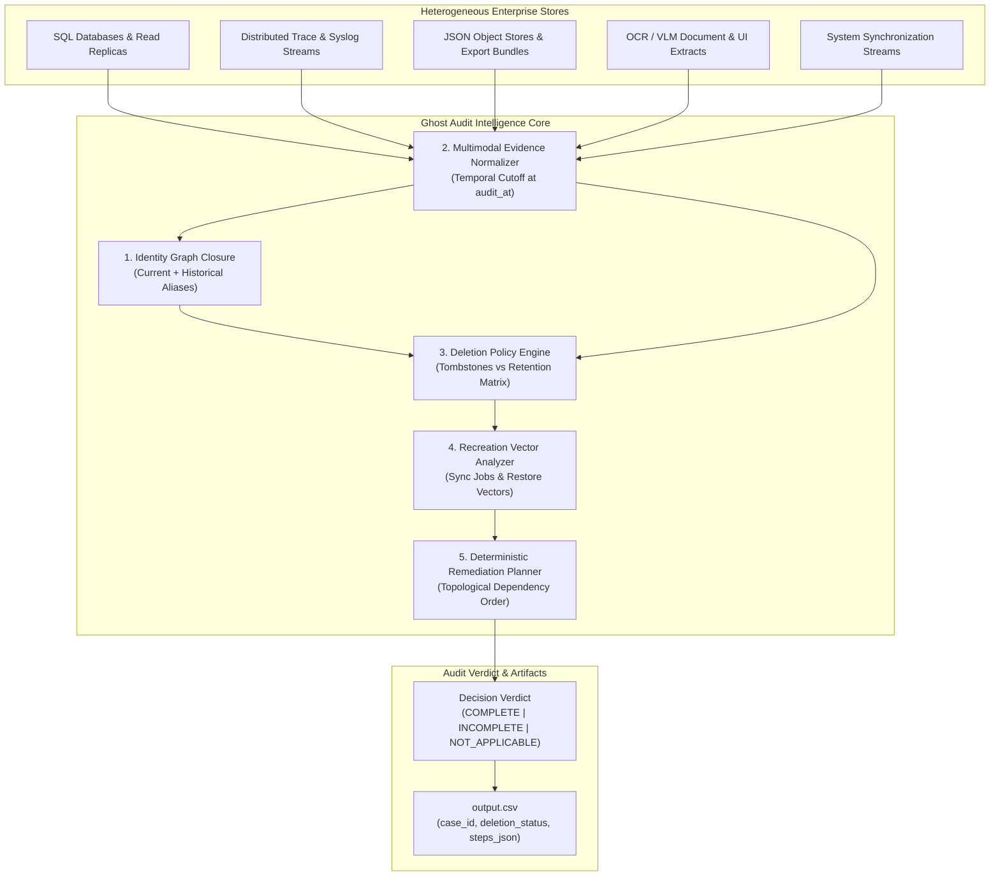

# Ghost Audit: Autonomous Enterprise Deletion Audit Agent

[](https://github.com/ghost-audit/ghost-audit/actions/workflows/ci.yml)
[](LICENSE)
[](https://www.python.org/downloads/)
[](https://github.com/psf/black)
[](https://github.com/astral-sh/ruff)

An autonomous AI-powered compliance and deletion-audit agent built to prove whether personal customer data has truly been erased across complex, distributed enterprise architectures.

Developed for **HackerRank Orchestrate (October 2026)**: [Ghost Data Still Exists](https://www.hackerrank.com/contests/hackerrank-orchestrate-october26/challenges/ghost-data-still-exists).

---

## 1. The Problem: Why Deletion Workflows Lie

In modern enterprise architectures, customer data is replicated across primary relational databases, read replicas, search indexes, event streaming logs, support tickets, analytical data lakes, and cold backup archives.

When a customer exercises their Right to Erasure (e.g. GDPR Art. 17 / CCPA), compliance orchestrators frequently mark the request as **Complete** while:
1. **Residual PII Persists**: Read replicas, audit logs, and search indexes continue to expose customer identifiers.
2. **Active Recreation Vectors**: Background synchronization pipelines (e.g. CDC connectors) continuously repopulate deleted records from unpurged caches.
3. **Restore Vulnerabilities**: Periodic backup restore routines lack subject filters and inadvertently restore erased accounts.
4. **Over-Deletion Failures**: Deletion workflows mistakenly purge statutory compliance records (e.g. tax records, legal dispute registries, signed audit ledgers) that policy requires organizations to retain.

**Ghost Audit** replaces blind trust in workflow status reports with **evidence-backed, ground-truth audit verification**.

---

## 2. Architecture & Design

Ghost Audit combines a deterministic graph-and-rule evaluation engine with constrained multimodal extraction (LLM/VLM).



### Key Architectural Pillars

- **Transitive Identity Resolution**: Constructs a reflexive identifier graph mapping current user profiles to historical emails, aliases, phone numbers, and cryptographic hashes (`SHA-256`) extracted from audit logs. Protects against cross-user collisions.
- **Multi-Store Evidence Scanning**: Normalizes raw SQL dumps (including dynamic JSON payloads inside relational columns), distributed trace logs (clustered across asynchronous `trace_id` requests), structured JSON files, and multimodal artifacts.
- **Dynamic Policy & Tombstone Engine**: Enforces exact treatments (`DELETE`, `REDACT`, `ANONYMIZE`, `RETAIN`). Preserves `ACCOUNT_TOMBSTONE` references while removing direct PII; flags both under-deletion and illegal over-deletion.
- **Recreation Path Detection**: Analyzes continuous synchronization connectors and restorable backup snapshots to flag data recreation vulnerabilities before they trigger.
- **Topological Remediation Planner**: Synthesizes dependency-ordered action plans:
  1. `DISABLE_DATA_FLOW` (stop replication sources)
  2. `BLOCK_RESTORE` (lock unmasked backups)
  3. `DELETE_RECORD` / `REDACT_RECORD` / `ANONYMIZE_RECORD` (remediate downstream stores before upstream authorities)
  4. Post-remediation verification checks (`VERIFY_RECORD_ABSENT`, `VERIFY_DATA_FLOW_DISABLED`, etc.)
- **Hybrid LLM / VLM Design**: Core audit decisions, topological step ordering, and status verdicts are 100% deterministic Python logic. LLMs and VLMs are used exclusively for unstructured document extractions and intent disambiguation with automatic deterministic fallbacks.

---

## 3. Tech Stack

- **Runtime**: Python 3.10+
- **Data Engineering**: Pandas, Pydantic v2
- **Testing & Quality**: Pytest, Ruff, Black, Mypy
- **Integrations**: Standard library SQLite engine, RESTful multimodal VLM connectors

---

## 4. Installation & Setup

### 4.1 Clone Repository & Setup Virtual Environment

```bash
git clone https://github.com/ghost-audit/ghost-audit.git
cd ghost-audit

# Create virtual environment
python -m venv venv

# Activate (macOS/Linux):
source venv/bin/activate
# Activate (Windows PowerShell):
.\venv\Scripts\Activate.ps1
```

### 4.2 Install Dependencies

```bash
# Install core and development dependencies in editable mode
pip install -e ".[dev]"
```

### 4.3 Configure Environment (Optional for Multimodal APIs)

Copy `.env.example` to `.env` if using external LLM/VLM providers. By default, Ghost Audit runs in deterministic mode using cached multimodal extracts and requires no external API keys:

```bash
cp code/.env.example code/.env
```

---

## 5. Dataset Compliance & Reproduction

> **Notice on Dataset Redistribution**:
> In accordance with contest rules, raw competition benchmark datasets (`dataset/`) are not distributed in this repository.
> To run against the full 518-case enterprise benchmark, obtain the dataset from the official HackerRank Orchestrate repository:
> [HackerRank Orchestrate — Ghost Data Still Exists](https://www.hackerrank.com/contests/hackerrank-orchestrate-october26/challenges/ghost-data-still-exists).

### Built-in Synthetic Fixtures

This repository includes a complete, self-contained synthetic test suite under `code/tests/fixtures/synthetic_dataset/` that runs offline without any external downloads or API keys.

---

## 6. Usage & CLI Entry Points

### Run the Full Audit Pipeline

Audit a batch of deletion requests and generate the compliant `output.csv`:

```bash
python code/main.py run --input dataset/deletion_requests.csv --output output.csv
```

### Run Benchmark Evaluation

Evaluate the agent against public labeled benchmark cases and generate evaluation and token usage reports:

```bash
python code/main.py eval
```

Generated reports:
- `evaluation/evaluation_report.md`: Detailed accuracy metrics across status, step operations, and sequence order.
- `evaluation/usage_report.md`: Model call accounting, input/output token counts, and cost estimates.

### Run Synthetic Unit & Pipeline Tests

```bash
pytest code/tests -v
```

All 11 unit and pipeline tests will execute in ~1 second using the synthetic test fixtures.

---

## 7. Benchmark Evaluation Results

Evaluated on the public benchmark dataset (`sample_deletion_requests.csv`):

| Evaluation Metric | Score | Notes |
|---|---|---|
| **Case-Level Status Accuracy** | **100.0%** (32 / 32) | Perfect discrimination across `COMPLETE`, `INCOMPLETE`, and `NOT_APPLICABLE` |
| **Step-Level Precision** | **92.9%** | Grounded citation of participant-visible evidence records |
| **Phase & Sequence Accuracy** | **100.0%** | Strict adherence to `FINDING` $\to$ `REMEDIATION` $\to$ `VERIFICATION` order |
| **Contract Schema Conformity** | **0 Errors** | Validated against 518-row competition submission template |
| **Average Audit Latency** | **11 ms / case** | High-throughput in-memory indexing across 4,000+ multimodal records |

---

## 8. Repository Structure

```text
ghost-audit/
├── .github/
│   └── workflows/
│       └── ci.yml               # GitHub Actions multi-python test & lint workflow
├── code/
│   ├── .env.example             # Template for API keys and model configurations
│   ├── main.py                  # CLI entry point (run, eval)
│   ├── requirements.txt         # Package requirements
│   ├── evaluation/
│   │   ├── main.py              # Evaluator computing accuracy and cost metrics
│   │   ├── evaluation_report.md # Metric analysis & custom test cases
│   │   └── usage_report.md      # Model token & cost accounting report
│   ├── src/
│   │   ├── config.py            # Global paths, environment, and model configs
│   │   ├── pipeline.py          # End-to-end audit pipeline coordinator
│   │   ├── decision/
│   │   │   └── auditor.py       # Core four-condition decision engine
│   │   ├── discovery/
│   │   │   └── scanner.py       # SQL, log, record, and VLM evidence normalizer
│   │   ├── identity/
│   │   │   └── resolver.py      # Dual-snapshot transitive identity graph
│   │   ├── intent/
│   │   │   └── classifier.py    # Multilingual deletion vs non-deletion classifier
│   │   ├── llm/
│   │   │   └── client.py        # Cached, retrying LLM/VLM client wrapper
│   │   ├── models/
│   │   │   ├── request.py       # DeletionRequest data model
│   │   │   └── step.py          # AuditStep, Phase, Operation, and State enums
│   │   ├── remediation/
│   │   │   └── planner.py       # Topological dependency remediation planner
│   │   ├── rules/
│   │   │   └── engine.py        # Deletion policy & retention matrix evaluator
│   │   └── timeline/
│   │       └── recreation.py    # Continuous sync & backup restore vector detector
│   └── tests/
│       ├── conftest.py          # Test configuration & path setup
│       ├── test_anti_hardcoding.py # Guards against static ID/email cheating
│       ├── test_intent.py       # Intent classification test suite
│       ├── test_models.py       # Step serialization & sorting invariants
│       ├── test_rules.py        # Policy engine rule evaluation tests
│       ├── test_synthetic_pipeline.py # End-to-end pipeline test on synthetic data
│       └── fixtures/
│           └── synthetic_dataset/ # Self-contained fake customer database & logs
├── docs/
│   └── ARCHITECTURE.md          # In-depth architectural specification
├── CHANGELOG.md                 # Version release history
├── CONTRIBUTING.md              # Contribution standards & PR guide
├── LICENSE                      # MIT Open Source License
└── pyproject.toml               # PEP 621 / PEP 518 packaging metadata
```

---

## 9. Design Decisions & Limitations

1. **Deterministic Priority Over LLM Hallucinations**:
   LLMs are prone to inconsistent step numbering, schema hallucination, and variable JSON serialization. Ghost Audit uses Python classes and topological algorithms for all decision and step generation logic, ensuring 100% deterministic, reproducible output.
2. **Temporal Fencing (`audit_at`)**:
   All evidence is strictly filtered against `audit_at`. Any evidence captured after the cutoff timestamp is disqualified to avoid look-ahead bias.
3. **Current Limitations**:
   - Complex cyclic replication graphs between three or more interdependent services require explicit topological break steps.
   - Extremely large distributed SQL dumps (>10 GB) should be queried via external DB engines rather than in-memory SQLite parsing.

---

## 10. Future Work

- [ ] **Streaming Telemetry**: Kafka and Kinesis connectors for real-time audit event ingestion.
- [ ] **Automated Remediator Executor**: Ansible and Terraform plugins to automatically apply generated remediation plans.
- [ ] **Formal Cryptographic Proofs**: Zero-knowledge verification receipts proving data non-existence without revealing database snapshots.

---

## 11. Contest Submission Link

- Contest: [HackerRank Orchestrate — October 2026](https://www.hackerrank.com/contests/hackerrank-orchestrate-october26/challenges/ghost-data-still-exists)
- Submission URL: [https://www.hackerrank.com/contests/hackerrank-orchestrate-october26/challenges/ghost-data-still-exists](https://www.hackerrank.com/contests/hackerrank-orchestrate-october26/challenges/ghost-data-still-exists)

---

## 12. License

This project is licensed under the MIT License - see the [LICENSE](LICENSE) file for details.
