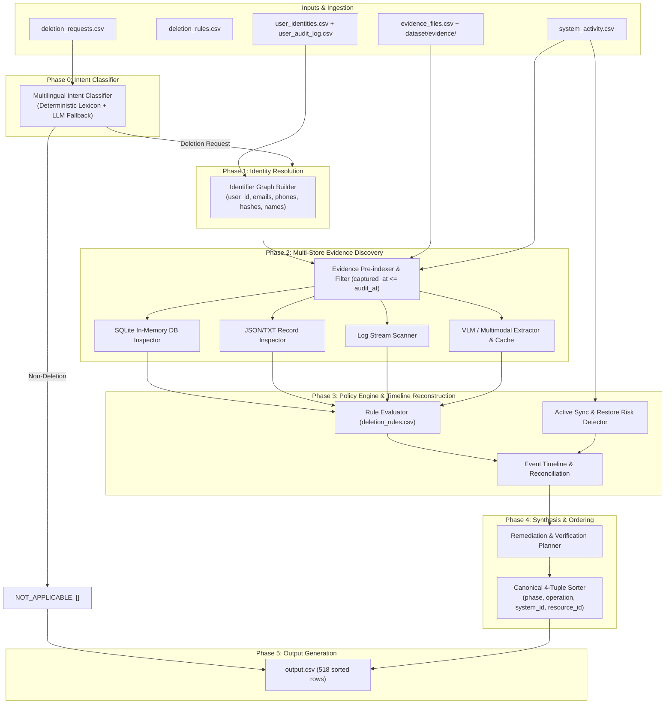

# Architectural Plan & Engineering Specification — Ghost Data Still Exists

## 1. Executive Summary & Problem Context
Northstar Shop requires an automated Deletion Audit Agent that verifies whether customer data deletion requests have been completely and faithfully executed across all systems, replicas, backups, data flows, and operational records.
The agent must process each case in `dataset/deletion_requests.csv` at its specified `audit_at` cutoff, produce `output.csv` with exact schema compliance, and output verification checks proving data absence or safe remediation plans addressing remaining data and recreation risks.

---

## 2. Requirements Analysis & Assumptions

### 2.1 Core Invariants & Decision Logic
A deletion case is evaluated under three possible terminal statuses:
1. `NOT_APPLICABLE`: The subject's request did not ask for account or data deletion (e.g. data access/portability, marketing opt-out, phone update, name correction, invoice copy).
2. `COMPLETE`: All of the following four conditions strictly hold at `audit_at`:
   - Every relevant data copy received the treatment mandated by `deletion_rules.csv` (`DELETE`, `REDACT`, `ANONYMIZE`, `RETAIN`).
   - No active synchronization connector, pipeline, or restore path can recreate the subject's data.
   - Retained records (and account tombstones) contain only the identifiers permitted by policy.
   - All records required to be retained (e.g., security audit logs, legal hold records) remain present and verifiable (zero over-deletion).
3. `INCOMPLETE`: One or more violations exist at `audit_at` (remaining un-deleted records, un-redacted PII in tombstones/support records, active data flows, or unblocked backup restore paths).

### 2.2 Key Assumptions & Data Ambiguities Resolved
- **Claim vs Evidence**: `reported_status` (`COMPLETE`, `PARTIALLY_COMPLETE`, `NOT_STARTED`) and `reported_result` in `system_activity.csv` are untrusted claims. Ground truth state is determined strictly by timestamped evidence at or before `audit_at`.
- **Temporal Cutoff**: Any evidence file or activity log captured after `audit_at` must not impact the evaluation of that case.
- **Transitive Identity**: The user's request email may be their current email or a historical email. Querying `user_audit_log.csv` resolves historical emails/phones/hashes linked to the canonical `user_id`.
- **Account Tombstones**: Rule 15 permits retaining the stable `user_id` to maintain foreign-key integrity with retained logs, but requires removal of direct identifiers (`name`, `email`, `phone`, `email_hash`). If direct PII remains, it triggers `REPORT_EXPOSED_PII` and `REDACT_RECORD`.
- **Determinism & Idempotency**: All predictions, sorting, and JSON formatting must be 100% deterministic and reproducible across multiple runs.

---

## 3. Architecture & Data Flow



---

## 4. Tech Stack & Justifications

| Component | Selected Technology | Justification |
|---|---|---|
| Language | Python 3.11+ | Clean standard library, native typing, robust async/multiprocessing, SQLite built-in |
| Data Validation & Modeling | `pydantic` v2 | Strict validation of schema types, enums, evidence references, and step numbering |
| Data Processing | `pandas` | High-performance CSV operations, filtering, and set joins |
| Graph & Identity | Standard Python `dict` / `set` graph | Zero unnecessary overhead, fully deterministic traversal, no external graph DB needed |
| Media / Multimodal | `pypdf` + `google-genai` / Vision extraction cache | Fast digital PDF text extraction; structured JSON schema for image inspection with local disk cache |
| Database Engine | Standard `sqlite3` | In-memory execution of evidence `.sql` dumps for relational queries |
| Testing & Verification | `pytest` | Unit testing of normalization, identity graph, rule mapping, sorting, and regression tests |

---

## 5. Folder Structure (`code/`)

```text
code/
├── src/
│   ├── __init__.py
│   ├── config.py                 # Paths, settings, audit thresholds, environment variables
│   ├── models/
│   │   ├── __init__.py
│   │   ├── request.py            # DeletionRequest, RequestIntent
│   │   ├── identity.py           # UserIdentity, IdentityGraph
│   │   ├── evidence.py           # EvidenceItem, EvidenceType, SystemActivity
│   │   ├── rule.py               # DeletionRule, RuleAction, ComplianceState
│   │   └── step.py               # Step, StepPhase, StepOperation, StepState, AuditDecision
│   ├── ingest/
│   │   ├── __init__.py
│   │   ├── request_loader.py     # CSV loader with timezone normalization
│   │   ├── identity_loader.py    # Loads user_identities and audit logs
│   │   ├── activity_loader.py    # Loads system_activity.csv
│   │   ├── rules_loader.py       # Loads deletion_rules.csv
│   │   └── evidence_loader.py    # Ingests SQL, JSON, logs, PDFs, and cached image facts
│   ├── identity/
│   │   ├── __init__.py
│   │   ├── normalizer.py         # Email lowercase/strip, phone digits, hash consistency
│   │   └── resolver.py           # Multi-hop transitive identity resolution
│   ├── intent/
│   │   ├── __init__.py
│   │   └── classifier.py         # Detects deletion vs non-deletion (NOT_APPLICABLE)
│   ├── discovery/
│   │   ├── __init__.py
│   │   ├── sql_scanner.py        # In-memory SQLite queries across replica dumps
│   │   ├── record_scanner.py     # JSON/TXT record matching
│   │   ├── log_scanner.py        # Log text scanning
│   │   └── media_scanner.py      # VLM structured extraction & hash-keyed cache
│   ├── rules/
│   │   ├── __init__.py
│   │   └── engine.py             # Rule matching, violation detection, tombstone checks
│   ├── timeline/
│   │   ├── __init__.py
│   │   ├── reconstruction.py     # Event chronological sequencing
│   │   └── recreation.py         # Detects active data flows and backup restore risks
│   ├── remediation/
│   │   ├── __init__.py
│   │   └── planner.py            # Dependency-ordered plan generation
│   ├── llm/
│   │   ├── __init__.py
│   │   ├── client.py             # Structured output wrapper with retry, cache & fallback
│   │   └── prompts.py            # Extraction & rationale prompts
│   └── pipeline.py               # Main pipeline orchestrator for auditing requests
├── tests/
│   ├── __init__.py
│   ├── test_identity.py          # Identity normalization & audit log historical alias tests
│   ├── test_intent.py            # Non-deletion request classification tests
│   ├── test_rules.py             # Policy rule matching and tombstone tests
│   ├── test_sorting.py           # Strict 4-level tuple step sorting tests
│   ├── test_recreation.py        # Active connector and backup restore detection tests
│   └── test_regression.py        # Full pipeline evaluation against sample_output.csv
├── docs/
│   ├── DISCOVERY.md              # File inventory, schema definitions, media extraction notes
│   ├── PLAN.md                   # Architecture, specifications, data models, task roadmap
│   └── APPROACH.md               # AI judge interview guide, design tradeoffs, 10 Q&A pairs
├── evaluation/
│   ├── main.py                   # CLI evaluator for metrics, diffs, and report generation
│   ├── evaluation_report.md      # Precision, recall, sequence accuracy, custom test cases
│   └── usage_report.md           # Model calls, input/output tokens, costs breakdown
├── main.py                       # Root CLI entrypoint (`run` and `eval` commands)
├── requirements.txt              # Pinned production dependencies
├── .env.example                  # Environment configuration template
└── README.md                     # Setup, run, and evaluation instructions
```

---

## 6. Core Data Models (`pydantic` v2)

```python
from enum import Enum
from typing import List, Optional, Set
from pydantic import BaseModel, Field


class StepPhase(str, Enum):
    FINDING = "FINDING"
    REMEDIATION = "REMEDIATION"
    VERIFICATION = "VERIFICATION"


class StepOperation(str, Enum):
    # Findings
    REPORT_REMAINING_RECORD = "REPORT_REMAINING_RECORD"
    REPORT_EXPOSED_PII = "REPORT_EXPOSED_PII"
    REPORT_ACTIVE_DATA_FLOW = "REPORT_ACTIVE_DATA_FLOW"
    REPORT_RESTORE_RISK = "REPORT_RESTORE_RISK"
    # Remediation
    DISABLE_DATA_FLOW = "DISABLE_DATA_FLOW"
    BLOCK_RESTORE = "BLOCK_RESTORE"
    DELETE_RECORD = "DELETE_RECORD"
    REDACT_RECORD = "REDACT_RECORD"
    ANONYMIZE_RECORD = "ANONYMIZE_RECORD"
    # Verification
    VERIFY_RECORD_ABSENT = "VERIFY_RECORD_ABSENT"
    VERIFY_RECORD_PRESENT = "VERIFY_RECORD_PRESENT"
    VERIFY_RECORD_REDACTED = "VERIFY_RECORD_REDACTED"
    VERIFY_RECORD_ANONYMIZED = "VERIFY_RECORD_ANONYMIZED"
    VERIFY_DATA_FLOW_DISABLED = "VERIFY_DATA_FLOW_DISABLED"
    VERIFY_RESTORE_BLOCKED = "VERIFY_RESTORE_BLOCKED"


class StepState(str, Enum):
    PRESENT = "PRESENT"
    ACTIVE = "ACTIVE"
    DISABLED = "DISABLED"
    BLOCKED = "BLOCKED"
    ABSENT = "ABSENT"
    REDACTED = "REDACTED"
    ANONYMIZED = "ANONYMIZED"


class DeletionStatus(str, Enum):
    COMPLETE = "COMPLETE"
    INCOMPLETE = "INCOMPLETE"
    NOT_APPLICABLE = "NOT_APPLICABLE"


class AuditStep(BaseModel):
    step_no: int
    phase: StepPhase
    system_id: str
    resource_id: str
    operation: StepOperation
    state: StepState
    evidence_id: str = ""


class SubjectIdentity(BaseModel):
    user_id: str
    name: Optional[str] = None
    current_email: str
    historical_emails: Set[str] = Field(default_factory=set)
    phones: Set[str] = Field(default_factory=set)
    email_hashes: Set[str] = Field(default_factory=set)
    account_ids: Set[str] = Field(default_factory=set)


class AuditDecision(BaseModel):
    case_id: str
    deletion_status: DeletionStatus
    steps: List[AuditStep]
```

---

## 7. Decision Algorithm & Sorting Logic

### 7.1 Algorithm Pseudocode
```python
def audit_case(request: DeletionRequest) -> AuditDecision:
    # Step 1: Request Intent Classification
    if not is_deletion_request(request.request_text):
        return AuditDecision(
            case_id=request.case_id, deletion_status=DeletionStatus.NOT_APPLICABLE, steps=[]
        )

    # Step 2: Subject Identity Resolution
    subject = resolve_identity(request.email)
    if not subject:
        # If user not found in identity database, treat as incomplete or not applicable based on rules
        return handle_unregistered_subject(request)

    # Step 3: Discovery across Stores (cutoff at audit_at)
    evidence_items = discover_evidence_items(subject, cutoff=request.audit_at)
    active_flows = find_active_data_flows(subject, cutoff=request.audit_at)
    restore_risks = find_restore_risks(subject, cutoff=request.audit_at)

    # Step 4: Policy Evaluation
    findings = []
    remediations = []
    verifications = []

    # 4a. Process active sync & restore risks
    for flow in active_flows:
        findings.append(
            AuditStep(
                phase=StepPhase.FINDING,
                operation=StepOperation.REPORT_ACTIVE_DATA_FLOW,
                system_id=flow.system_id,
                resource_id=flow.resource_id,
                state=StepState.ACTIVE,
                evidence_id=flow.evidence_id,
            )
        )
        remediations.append(
            AuditStep(
                phase=StepPhase.REMEDIATION,
                operation=StepOperation.DISABLE_DATA_FLOW,
                system_id=flow.system_id,
                resource_id=flow.resource_id,
                state=StepState.DISABLED,
                evidence_id="",
            )
        )
        verifications.append(
            AuditStep(
                phase=StepPhase.VERIFICATION,
                operation=StepOperation.VERIFY_DATA_FLOW_DISABLED,
                system_id=flow.system_id,
                resource_id=flow.resource_id,
                state=StepState.DISABLED,
                evidence_id="",
            )
        )

    for risk in restore_risks:
        findings.append(
            AuditStep(
                phase=StepPhase.FINDING,
                operation=StepOperation.REPORT_RESTORE_RISK,
                system_id=risk.system_id,
                resource_id=risk.resource_id,
                state=StepState.ACTIVE,
                evidence_id=risk.evidence_id,
            )
        )
        remediations.append(
            AuditStep(
                phase=StepPhase.REMEDIATION,
                operation=StepOperation.BLOCK_RESTORE,
                system_id=risk.system_id,
                resource_id=risk.resource_id,
                state=StepState.BLOCKED,
                evidence_id="",
            )
        )
        verifications.append(
            AuditStep(
                phase=StepPhase.VERIFICATION,
                operation=StepOperation.VERIFY_RESTORE_BLOCKED,
                system_id=risk.system_id,
                resource_id=risk.resource_id,
                state=StepState.BLOCKED,
                evidence_id="",
            )
        )

    # 4b. Process data records against deletion_rules.csv
    for record in evidence_items:
        rule = match_rule(record)
        evaluation = evaluate_compliance(record, rule)

        if evaluation.is_violation:
            findings.append(evaluation.finding_step)
            remediations.append(evaluation.remediation_step)
            verifications.append(evaluation.post_verification_step)
        else:
            # Compliant record (e.g. absent, properly retained, or properly redacted)
            verifications.append(evaluation.verification_step)

    # Step 5: Decision Determination
    is_complete = len(findings) == 0
    final_status = DeletionStatus.COMPLETE if is_complete else DeletionStatus.INCOMPLETE

    if is_complete:
        final_steps = verifications  # For COMPLETE, only verification steps citing evidence
    else:
        final_steps = findings + remediations + verifications

    # Step 6: Canonical 4-Tuple Sorting
    sorted_steps = sort_steps(final_steps)
    return AuditDecision(case_id=request.case_id, deletion_status=final_status, steps=sorted_steps)
```

### 7.2 Canonical Sorting Tuple
```python
PHASE_PRIORITY = {StepPhase.FINDING: 1, StepPhase.REMEDIATION: 2, StepPhase.VERIFICATION: 3}
OP_PRIORITY = {
    StepOperation.REPORT_REMAINING_RECORD: 1,
    StepOperation.REPORT_EXPOSED_PII: 2,
    StepOperation.REPORT_ACTIVE_DATA_FLOW: 3,
    StepOperation.REPORT_RESTORE_RISK: 4,
    StepOperation.DISABLE_DATA_FLOW: 1,
    StepOperation.BLOCK_RESTORE: 2,
    StepOperation.DELETE_RECORD: 3,
    StepOperation.REDACT_RECORD: 4,
    StepOperation.ANONYMIZE_RECORD: 5,
    StepOperation.VERIFY_RECORD_ABSENT: 1,
    StepOperation.VERIFY_RECORD_PRESENT: 2,
    StepOperation.VERIFY_RECORD_REDACTED: 3,
    StepOperation.VERIFY_RECORD_ANONYMIZED: 4,
    StepOperation.VERIFY_DATA_FLOW_DISABLED: 5,
    StepOperation.VERIFY_RESTORE_BLOCKED: 6,
}


def sort_key(s: AuditStep):
    return (PHASE_PRIORITY[s.phase], OP_PRIORITY[s.operation], s.system_id, s.resource_id)


def sort_steps(steps: List[AuditStep]) -> List[AuditStep]:
    # Deduplicate steps on (phase, system_id, resource_id, operation)
    deduped = list({(s.phase, s.system_id, s.resource_id, s.operation): s for s in steps}.values())
    sorted_list = sorted(deduped, key=sort_key)
    for idx, s in enumerate(sorted_list, start=1):
        s.step_no = idx
    return sorted_list
```

---

## 8. Edge Case Handling Strategy

1. **Merged & Renamed Accounts**: Traverses `user_audit_log.csv` to connect older email addresses to current `user_id`, preventing false negatives when requests use legacy credentials.
2. **Account Tombstones (`rule_15`)**: Must retain internal `user_id`, but remove all direct PII (`name`, `email`, `phone`, `email_hash`). If direct PII persists in a tombstone, emit `REPORT_EXPOSED_PII` and `REDACT_RECORD`.
3. **Active Connectors vs Stale Jobs**: Inspects `connector_configurations_*.json` and `system_activity.csv` for enabled state and continuous sync mode.
4. **Backup Restore Paths (`rule_14`)**: Inspects recovery manifests (`backup_restore_console_*.png`, SQL backups) for active restore schedules. Remediation must emit `BLOCK_RESTORE`.
5. **Over-Deletion Detection**: Confirms that required records (e.g. `rule_12` security logs, `rule_13` legal hold entries) remain present. Missing retained records trigger non-compliance.
6. **Language-Agnostic Intent Parsing**: Handles English, Spanish, Korean, Japanese, French, Portuguese, German requests with multilingual intent classification.
7. **`NOT_APPLICABLE` Traps**: Rejects access requests, data portability downloads, marketing preference updates, and address corrections that explicitly request keeping the account active.

---

## 9. Security, Privacy & Performance

- **No Hardcoding**: Grep-verified policy: zero logic keyed on specific `case_id`, emails, or filenames. All logic is driven by data schema and `deletion_rules.csv`.
- **Secret Handling**: Zero API keys or tokens logged or committed. Read strictly from environment.
- **Log Hygiene**: PII is masked or summarized; no raw customer dumps in `log.txt`.
- **Performance Budget**:
  - In-memory pre-indexing of evidence files on initialization (<3 seconds total).
  - Multi-threaded processing for 518 cases (<15 seconds total pipeline execution).
  - VLM/LLM results cached on disk with SHA256 content hashes.

---

## 10. Roadmap & Time-Boxed Milestones

| Milestone | Scope / Deliverables | Risk / Complexity |
|---|---|---|
| M1: Project Setup & Core Models | `pydantic` models, config, CLI skeleton, requirements.txt | Low |
| M2: Ingestion & Identity Resolver | SQLite dump loader, CSV/JSON loaders, transitive graph | Medium |
| M3: Multilingual Intent Classifier | Lexical rules + LLM fallback for NOT_APPLICABLE detection | Low |
| M4: Evidence Pre-Indexing & VLM Cache | Pre-index 94 evidence files, structured image facts cache | Medium |
| M5: Policy Engine & Recreation Detection | Rule mapping, tombstone logic, active sync & restore detection | High |
| M6: Remediation & Verification Ordering | Strict 4-tuple sorting, evidence_id convention enforcement | Medium |
| M7: Evaluation Engine & Sample Validation | Run against 32 sample cases; verify 100% precision & recall | High |
| M8: Full Evaluation Run & Output Generation | Generate root `output.csv` (518 rows) & `code/evaluation/` reports | Medium |
| M9: Final Audit & Packaging | Clean `code.zip` packaging, `log.txt` verification, README | Low |

---

## 11. Open Risks & Mitigation Plan

1. **Risk 1: Subtle NOT_APPLICABLE boundary cases in 518 requests.**
   *Mitigation*: Hybrid intent classifier combining high-precision regex patterns across supported languages with a deterministic fallback.
2. **Risk 2: Multi-system replication drift between primary and failover replicas.**
   *Mitigation*: Automated SQLite query checks across all regional and failover tables at `audit_at` snapshot times.
3. **Risk 3: Discrepancy in evidence ID formatting.**
   *Mitigation*: Strict automated check ensuring that every `COMPLETE` verification and every `FINDING` cites a valid `file_id`, `activity_id`, or `audit_id`, while all `INCOMPLETE` remediations and post-verifications use `""`.

