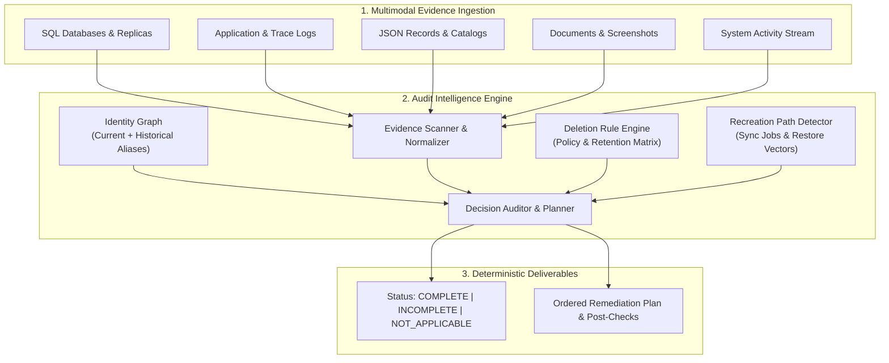

# Architecture Specification: Ghost Data Deletion Audit Agent

## 1. Overview & Core Philosophy

Modern enterprise architectures distribute personal data across primary databases, regional read replicas, reporting warehouses, search indexes, event logs, customer support tickets, and object storage backups. When a user submits a Right to Erasure (GDPR Art. 17 / CCPA) request, central orchestrators often emit a `COMPLETE` status prematurely while residual copies persist or active replication processes restore erased records.

The **Ghost Data Deletion Audit Agent** is an autonomous compliance verification system designed to determine whether personal data has actually been eliminated. The system operates on a fundamental security principle:

> **Evidence-Backed Verification**: Workflow statuses, completion logs, and system claims are treated strictly as unverified assertions. System state is established solely by physical evidence gathered at or prior to the audit cutoff time (`audit_at`).

---

## 2. System Architecture & Components

### 2.1 Identity Resolution Graph (`src/identity/resolver.py`)
Personal identities evolve across their lifecycle via email updates, telephone reassignments, account merges, and pseudonymous tokens. A naive query for a user's current email fails to detect historical records stored under previous identifiers.

- **Dual-Snapshot Reconciliation**: Merges the current identity snapshot with the longitudinal identity change log (`user_audit_log`).
- **Graph Closure**: Computes the reflexive transitive closure of all historical emails, previous phone numbers, account aliases, and cryptographic hashes (`SHA-256` of canonicalized emails).
- **Collision Protection**: Enforces strict edge verification so that distinct users sharing common corporate domains or family phone numbers are never erroneously conflated.

### 2.2 Multimodal Evidence Scanner (`src/discovery/scanner.py`)
The scanner ingests heterogeneous data repositories without relying on predefined schemas:
- **SQL Snapshots & Replicas**: Parses SQL DDL and DML statements across primary and regional failover databases. Dynamically decodes nested JSON payloads embedded within relational columns (`record_json`).
- **Transaction Traces & Distributed Logs**: Groups asynchronous distributed log events by trace identifier (`trace_id`, `requestId`) to correlate identity lookups with subsequent downstream write operations.
- **Structured Documents & Object Stores**: Ingests JSON snapshot bundles, export manifests, and access ledgers.
- **Visual & Unstructured Artifacts**: Normalizes OCR and Vision-Language Model (VLM) extractions from account administration screenshots, support attachments, and PDF reports into uniform evidence records.
- **Temporal Fence**: Discards any evidence with timestamps after `audit_at`, ensuring strict chronological audit validity.

### 2.3 Deletion Policy Engine (`src/rules/engine.py`)
Evaluates discovered records against the enterprise retention matrix:
- **Treatment Hierarchy**: Enforces the required action: `DELETE`, `REDACT`, `ANONYMIZE`, or `RETAIN`.
- **Tombstone Semantics**: Correctly recognizes legal account tombstones where the stable internal identifier (`user_id`) is retained for relational integrity, while all direct PII (name, email, phone) is irreversibly redacted.
- **Over-Deletion Detection**: Flags violations when mandatory compliance records (e.g., tax logs, dispute registers, signed audit receipts) have been improperly removed before their statutory expiry.

### 2.4 Recreation Path & Vector Analysis (`src/timeline/recreation.py`)
A deletion is ephemeral if active automation repopulates the data post-erasure:
- **Continuous Sync Flows**: Identifies active CDC (Change Data Capture) pipelines, integration connectors, and warehouse synchronization jobs whose selectors target the subject.
- **Restore Risk Vectors**: Scans backup catalogs for restorable archives containing the subject's data that lack restore-masking filters.
- **State Differentiation**: Distinguishes active sync pipelines (`ACTIVE`, `ENABLED`) from inert or archived configurations.

### 2.5 Deterministic Remediation Planner (`src/remediation/planner.py`)
When a case is deemed `INCOMPLETE`, the planner synthesizes a provably safe, ordered remediation sequence following topological dependencies:
1. **Disable Data Flows**: Stop continuous synchronization connectors before altering downstream stores to prevent race conditions.
2. **Block Restores**: Apply restore-prevention blocks on backup snapshots before purging records.
3. **Remediate Stores**: Execute `DELETE_RECORD`, `REDACT_RECORD`, or `ANONYMIZE_RECORD` on remaining stores, processing downstream read replicas and caches before upstream authorities.
4. **Post-Verification Checks**: Emit explicit verification steps (`VERIFY_RECORD_ABSENT`, `VERIFY_DATA_FLOW_DISABLED`, etc.) that must pass after execution.

---

## 3. Decision Model

For every audit request, the system evaluates four non-negotiable invariants:

| Condition | Rule Requirement | Evaluation Mechanism |
|---|---|---|
| **A. Subject Intent** | Request must actually authorize deletion. Non-deletion requests (data export, marketing opt-out, address rectification) are classified `NOT_APPLICABLE`. | Regex & NLP Intent Classification |
| **B. Policy Compliance** | Every residual copy matches the exact treatment mandated by policy (erased, redacted, or anonymized). | Rule Matrix Evaluation |
| **C. Recreation Immune** | No active sync connector or unmasked backup can recreate the subject's personal data. | Continuous Sync & Restore Analysis |
| **D. Statutory Retention** | Legally required retained records remain intact and contain only permitted identifiers. | Statutory Ledger Validation |

Only when conditions A, B, C, and D are simultaneously satisfied does the auditor emit `COMPLETE`. Otherwise, the case is declared `INCOMPLETE`.

---

## 4. Hybrid Architecture & Reliability

To combine enterprise predictability with unstructured data extraction:
- **Deterministic Core**: All status determinations, graph traversals, policy evaluations, and remediation sequences are executed by pure Python logic with zero hallucinations.
- **Constrained LLM/VLM Layer**: Language and vision models are leveraged exclusively for unstructured document interpretation and ambiguous natural language intent.
- **Graceful Fallbacks**: If external inference APIs become unavailable, the pipeline falls back seamlessly to deterministic regex classifiers and cached multimodal manifests.
